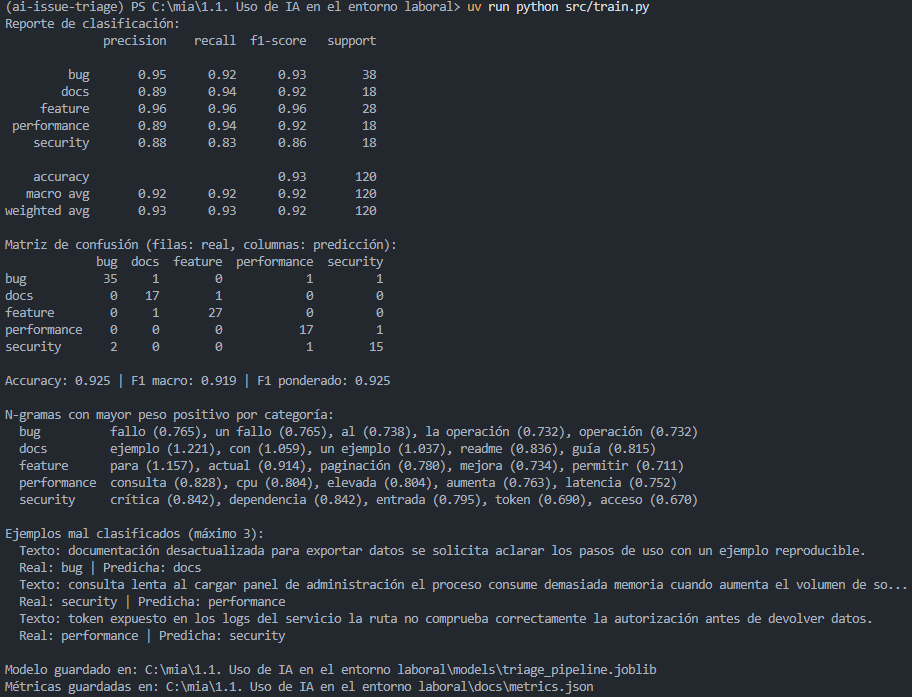

# AI Issue Triage

Clasificador supervisado para apoyar el triaje de incidencias técnicas en equipos de desarrollo de software.

## Descripción del problema y objetivo del MVP

Los equipos reciben incidencias de distintos tipos y necesitan clasificarlas con rapidez para encaminarlas al área adecuada. El MVP aprende de ejemplos etiquetados para asignar cada nuevo ticket a `bug`, `feature`, `performance`, `security` o `docs`. Es una ayuda para priorizar y organizar el trabajo, no sustituye la revisión humana, especialmente ante incidencias de seguridad.

## Documentación técnica detallada

- [Arquitectura y funcionamiento interno](docs/ARQUITECTURA.md): flujo de datos, dataset, pipeline y lectura de métricas.
- [Guía de ejecución paso a paso](docs/GUIA_EJECUCION.md): instalación de `uv`, comandos, salidas verificadas y solución de problemas.

## Arquitectura y algoritmo

El MVP aplica aprendizaje supervisado mediante un `Pipeline` de scikit-learn con TF-IDF (n-gramas 1–2) y regresión logística. Una partición estratificada reserva el 20% de los 600 tickets para evaluación; el pipeline aprende el vocabulario solo con entrenamiento para evitar *data leakage*. El detalle de diseño se documenta en [Arquitectura](docs/ARQUITECTURA.md).

Métricas reales de la ejecución actual de `train.py`:

| Métrica | Valor |
|---|---:|
| Accuracy | 0.925 |
| F1 macro | 0.919 |
| F1 ponderado | 0.925 |

El informe completo y la matriz de confusión se guardan en [`docs/metrics.json`](docs/metrics.json). Las métricas son de datos sintéticos y no predicen el rendimiento sobre incidencias reales.

## Evaluación crítica del enfoque de Machine Learning

TF-IDF con regresión logística ofrece entrenamiento e inferencia rápidos, bajo consumo de recursos y cierta interpretabilidad: los pesos positivos muestran qué n-gramas se asocian a cada categoría, y `--explain` destaca los términos que contribuyeron a una predicción. Sin embargo, el modelo se basa en coincidencias de palabras y no comprende bien el contexto. Por ejemplo, puede confundir solicitudes de documentación con un bug, como el ticket de prueba «documentación desactualizada para exportar datos…» (real: `bug`, predicha: `docs`). También confundió una incidencia de seguridad que mencionaba «consulta lenta» y «memoria» con `performance` (real: `security`); y una incidencia de `performance` que mencionaba un token expuesto fue predicha como `security`.

Las negaciones («no hay error») y el lenguaje ambiguo pueden invertir el sentido sin cambiar las palabras clave; el vocabulario fuera del dominio (*out-of-vocabulary*) no aporta características TF-IDF y deja poca evidencia para decidir. Además, estos errores proceden de una partición de prueba de datos sintéticos, así que las métricas y explicaciones requieren validación con tickets reales y revisión humana antes de usarse para priorizar, especialmente en seguridad.

## Investigación y mapeo crítico de herramientas de IA

| Herramienta y categoría | Integración en el flujo | Ventajas observables | Limitaciones y riesgos |
|---|---|---|---|
| Google Gemini — planificación, diseño y consultoría técnica | Interfaz web conversacional empleada de forma iterativa antes y durante el desarrollo para definir el alcance del MVP, validar el paradigma supervisado (`TF-IDF + LogisticRegression`), estructurar especificaciones técnicas (`SPEC.md`) y resolver dudas conceptuales. | Desglosa requisitos ambiguos en especificaciones estructuradas, ayuda a detectar riesgos metodológicos antes de escribir código (como *data leakage* o datasets triviales) y adapta la arquitectura a herramientas concretas como `uv`. | Al operar fuera del repositorio, no tiene acceso directo en tiempo real al sistema de archivos ni ejecución de terminal. El desarrollador debe trasladar manualmente el contexto y verificar que las propuestas encajen con el estado real del código. |
| GitHub Copilot Coding Agent y Code Review — implementación, testing, documentación y revisión de Pull Requests | Integrado nativamente en el repositorio de GitHub en dos roles complementarios: el Coding Agent se asigna a *Issues* para desarrollar funcionalidades en ramas aisladas y abrir *Pull Requests*; Copilot Code Review analiza automáticamente los *diffs* antes de integrarlos en `main`. | Automatiza la creación de módulos, tests unitarios, flujos de CI y documentación técnica a partir de especificaciones bien acotadas, y aporta una primera capa automatizada de revisión para detectar errores sintácticos, inconsistencias o mejoras de estilo. | Su eficacia depende de la precisión del *prompt* o *Issue* inicial. En la revisión de *Pull Requests* puede centrarse en aspectos superficiales sin detectar fallos de lógica de dominio o metodología de *Machine Learning*, por lo que exige supervisión humana antes del *merge*. |
| GitHub Issues, Pull Requests y GitHub Actions — gestión de proyectos y verificación automatizada | Herramientas nativas del repositorio remoto para planificar tareas por hitos (*Issues*), auditar cambios generados por el agente (*PR diffs*) y validar automáticamente la suite (`uv run pytest -v`) en cada *Pull Request* o *push* a `main`. | Proporcionan trazabilidad entre cada requisito, la intervención del agente, la revisión de código y la verificación automática, ayudando a evitar la integración de cambios que rompan la ejecución. | Un *pipeline* en verde solo indica que pasan los tests actuales; sin revisión humana crítica de la cobertura y del diseño en los PRs, pueden pasar desapercibidos casos límite o decisiones arquitectónicas subóptimas. |

Estas herramientas son complementarias: la IA propone y ayuda a ejecutar, mientras que las decisiones de diseño, la revisión de calidad y la responsabilidad de integrar siguen en manos del equipo.

### Herramientas utilizadas en este proyecto

Se utilizó **Google Gemini** como asistente conversacional para planificar, diseñar y resolver dudas; **GitHub Copilot Coding Agent** para implementar tareas asignadas mediante *Issues*; y **GitHub Copilot Code Review** para analizar *Pull Requests*. **GitHub Issues, Pull Requests y Actions** aportaron planificación, trazabilidad y verificación continua. Las propuestas y revisiones automatizadas se contrastaron con el código, las pruebas y los resultados ejecutados.

## Distribución por fase del MVP

| Fase | Uso propuesto |
|---|---|
| Planificación y diseño arquitectónico | **Gemini + GitHub Issues:** selección del paradigma supervisado, definición de categorías del dataset, prevención de *data leakage* mediante `Pipeline` y redacción iterativa de especificaciones técnicas. |
| Implementación del código y entorno `uv` | **GitHub Copilot Coding Agent:** inicialización del proyecto con `pyproject.toml` y `uv.lock`, y desarrollo de `generate_dataset.py`, `utils.py`, `train.py` y `predict.py` (incluido el modo `--explain`). |
| Revisión de código, testing y CI | **GitHub Copilot Code Review + pytest + GitHub Actions:** creación de `tests/test_pipeline.py`, análisis automatizado de cada *Pull Request* mediante Copilot Code Review y validación continua en `.github/workflows/ci.yml`. |
| Documentación y auditoría humana | **Gemini + Copilot + revisión manual:** generación de `docs/ARQUITECTURA.md` y `docs/GUIA_EJECUCION.md`, inspección manual de comentarios y *diffs* de cada PR antes del *merge* y captura local de evidencias. |

## Requisitos, instalación y ejecución

Se requiere Python 3.11 o superior y [`uv`](https://docs.astral.sh/uv/). Desde la raíz del proyecto, sincroniza el entorno y ejecuta los pasos principales:

```bash
uv sync
uv run python src/generate_dataset.py
uv run python src/train.py
uv run python src/predict.py --demo
uv run pytest -v
```

Para clasificar un texto individual:

```bash
uv run python src/predict.py --text "La API devuelve HTTP 500 al guardar un registro"
```

El entrenamiento genera `models/triage_pipeline.joblib` y actualiza `docs/metrics.json`; `uv.lock` fija las dependencias. Consulta la [Guía de ejecución](docs/GUIA_EJECUCION.md) para instalación, explicación de los comandos, ejemplos completos de salidas y solución de problemas.

## Bitácora de desarrollo asistido por IA

| Iteración y herramientas | Riesgo o necesidad detectada | Decisión humana y resultado |
|---|---|---|
| Definición inicial y prevención de *data leakage* (**Gemini → Copilot Agent**) | Al plantear el clasificador en Gemini, se detectó el riesgo de aplicar `TfidfVectorizer` antes de `train_test_split`; un dataset sintético trivial también podía generar métricas artificialmente perfectas. | Exigir en la especificación un `sklearn.pipeline.Pipeline` encapsulado y solapamiento realista en el dataset sintético. |
| Estandarización del entorno con `uv` (**Gemini → Copilot Agent**) | La especificación inicial se basaba en `pip` y `requirements.txt`, lo que no correspondía al entorno elegido para el proyecto. | Ajustarla para migrar a `uv` (`pyproject.toml` + `uv.lock`) y facilitar una reproducibilidad consistente entre entornos. |
| Ampliación de documentación técnica (**Gemini → Copilot Agent**) | El `README.md` resultaba insuficiente para explicar el funcionamiento interno y la ejecución detallada. | Crear un *Issue* específico para generar `docs/ARQUITECTURA.md` y `docs/GUIA_EJECUCION.md` con salidas reales de terminal. |
| Explicabilidad e integración continua (**Gemini → Copilot Agent**) | Se necesitaba entender qué palabras impulsan cada predicción y automatizar la comprobación de pruebas. | Incorporar `--explain` en `predict.py`, análisis de errores en `train.py` y `.github/workflows/ci.yml` para ejecutar `pytest` en cada PR. |
| Revisión de Pull Requests y validación local (**Copilot Code Review + criterio humano**) | La revisión automatizada puede pasar por alto problemas de lógica o sugerir cambios que no encajan con el dominio; los enlaces y comandos también deben corresponder al proyecto real. | Analizar las PRs con Copilot Code Review, filtrar sus sugerencias con criterio humano, verificar enlaces internos y ejecutar localmente los comandos de demostración para capturar evidencias reales. |

## Verificación y evidencias (capturas)




