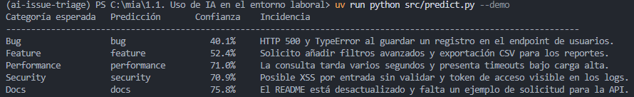
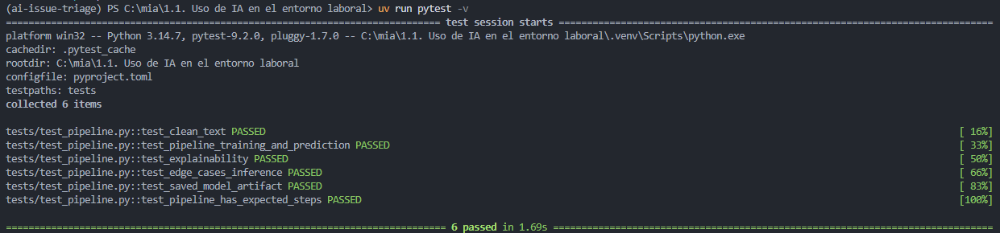

# Memoria técnica: AI Issue Triage

**Clasificador supervisado de incidencias técnicas**

Repositorio: [alcorher/1.1.-Uso-de-IA-en-el-entorno-laboral](https://github.com/alcorher/1.1.-Uso-de-IA-en-el-entorno-laboral)


## 1. Proyecto y problema

Los equipos de desarrollo reciben incidencias que deben encaminarse al área adecuada. Este MVP clasifica el título y la descripción de un ticket en una de cinco categorías: `bug`, `feature`, `performance`, `security` o `docs`. Es una ayuda para organizar el trabajo, no sustituye la revisión humana ni la evaluación de prioridad; toda alerta de seguridad necesita revisión especializada.

El repositorio contiene el generador de datos, el entrenamiento y evaluación, la interfaz CLI, pruebas, documentación técnica y capturas:

```text
data/tickets_dataset.csv       Datos etiquetados sintéticos
docs/                          Arquitectura, guía, métricas y capturas
models/triage_pipeline.joblib  Pipeline entrenado
src/                           Generación, limpieza, entrenamiento e inferencia
tests/                         Pruebas automatizadas con pytest
.github/workflows/ci.yml       Configuración de integración continua
pyproject.toml, uv.lock        Dependencias y versiones bloqueadas
```

Detalles adicionales: [arquitectura](docs/ARQUITECTURA.md) y [guía de ejecución](docs/GUIA_EJECUCION.md).

## 2. Herramientas de IA y flujo de trabajo

La tabla distingue el uso documentado de lo que se pudo comprobar en el repositorio y en GitHub. Las ventajas y los riesgos describen capacidades esperables; no implican que cada propuesta haya sido acertada en este proyecto.

| Herramienta / categoría | Integración y uso | Ventajas | Limitaciones y evidencia |
|---|---|---|---|
| **Google Gemini — planificación y consulta técnica** | La bitácora del proyecto declara su uso para definir el alcance, discutir el paradigma y estructurar especificaciones. Interfaz web externa al repositorio. | Ayuda a convertir requisitos en tareas y a plantear riesgos metodológicos antes de programar. | Las conversaciones no están versionadas; su uso y sus aportaciones no se pueden verificar de forma independiente desde el repositorio. Las propuestas deben contrastarse con el código y la ejecución. |
| **GitHub Copilot Coding Agent — programación agéntica** | Issues asignados a Copilot y PRs creadas desde ramas `copilot/...`; por ejemplo, [PR #3](https://github.com/alcorher/1.1.-Uso-de-IA-en-el-entorno-laboral/pull/3), [PR #5](https://github.com/alcorher/1.1.-Uso-de-IA-en-el-entorno-laboral/pull/5) y [PR #7](https://github.com/alcorher/1.1.-Uso-de-IA-en-el-entorno-laboral/pull/7). | Produce cambios trazables que se pueden revisar mediante el diff, ejecutar y probar antes de integrar. | Puede interpretar mal requisitos o generar soluciones incompletas; la asignación del agente no demuestra por sí sola la corrección del resultado. Requiere revisión humana y pruebas. |
| **GitHub Issues, Pull Requests y Actions — gestión y verificación** | Issues para acotar tareas, PRs para revisar cambios y `ci.yml` para ejecutar `uv sync --frozen` y `uv run pytest -v` en `push` y `pull_request` a `main` o `master`. | Conserva trazabilidad entre requisitos y cambios; la automatización permite repetir las pruebas al integrar código. | La CI solo comprueba las pruebas existentes, no la calidad del dataset ni todos los casos límite. En la consulta de ejecuciones de Actions no aparecieron runs de `ci.yml`; por ello, la verificación descrita aquí es local, no una CI remota confirmada. |

**Copilot Code Review:** se solicitaron revisiones en PR #3, #5 y #7, pero en los tres casos el bot indicó que no pudo revisar por cuota insuficiente. Por tanto, no se afirma que esas PR recibieran una revisión automática completada; sus cambios debían contrastarse manualmente.

**Privacidad, costes y fiabilidad:** no se usaron tickets reales ni se midieron costes, así que no se atribuyen cifras ni garantías a los proveedores. Antes de enviar código o datos a servicios externos se deben revisar las condiciones de privacidad y evitar información confidencial. Las respuestas de IA pueden contener errores o afirmaciones inventadas; contrastarlas con el repositorio, las pruebas y la revisión humana es parte del flujo, no una garantía de ausencia de defectos.

### Uso por fase

- **Planificación:** Gemini, según la bitácora del proyecto, e Issues para convertir necesidades en tareas.
- **Implementación:** Copilot Coding Agent en tareas asignadas mediante Issues.
- **Pruebas y revisión:** pytest y revisión de diffs; Copilot Code Review fue solicitado pero no completado por cuota. El workflow de Actions está configurado, aunque no se encontró una ejecución remota de `ci.yml`.
- **Documentación:** documentación en español y auditoría humana de comandos, métricas, resultados y capturas.

## 3. Demo y paradigma de aprendizaje

**Paradigma:** aprendizaje supervisado multiclase. El dataset contiene 600 tickets sintéticos con etiquetas. El generador usa plantillas deterministas con semilla `42`, incluye vocabulario solapado y reasigna al azar a una categoría relacionada el 10% de las etiquetas para simular ruido. La distribución resultante es: `bug` 188, `feature` 140, `performance` 91, `security` 91 y `docs` 90.

**Algoritmo:** un `sklearn.pipeline.Pipeline` con `TfidfVectorizer(ngram_range=(1, 2), max_features=3000, sublinear_tf=True)` y `LogisticRegression(max_iter=1000, class_weight="balanced", random_state=42)`. La partición estratificada reserva el 20% (120 ejemplos) para evaluación. Como el vectorizador está dentro del pipeline y el ajuste se hace solo con los datos de entrenamiento, el vocabulario y los pesos IDF no se aprenden de la partición de prueba.

**MVP:** generar el CSV, entrenar y guardar el pipeline, clasificar un texto con probabilidades, ejecutar una demo de cinco ejemplos y mostrar términos explicativos con `--explain`. Las pruebas cubren limpieza, entrenamiento, inferencia, casos límite, explicabilidad y el artefacto guardado.

### Resultados y limitaciones

La última ejecución reproducible de entrenamiento obtuvo **accuracy 0.925**, **F1 macro 0.919** y **F1 ponderado 0.925** sobre los 120 ejemplos de prueba. El informe y la matriz están en [docs/metrics.json](docs/metrics.json). Son resultados del dataset sintético y no estiman el rendimiento sobre incidencias reales.

La revisión de ejemplos erróneos impresos por el entrenamiento encontró casos con texto claramente asociado a una clase, pero etiqueta real distinta; por ejemplo, una incidencia sobre una consulta lenta etiquetada como `security` y predicha `performance`, y una sobre token expuesto etiquetada como `performance` y predicha `security`. Esto concuerda con el cambio aleatorio de etiquetas del generador: parte del error medido es *label noise*, no necesariamente un fallo semántico del clasificador. También existe una confusión realista entre vocabularios cercanos. TF-IDF no comprende negaciones ni contexto, y palabras nuevas fuera del vocabulario no aportan señal. Se necesita validación con datos reales y revisión humana antes de cualquier uso operativo.

## 4. Requisitos, instalación y demostración

Requisitos declarados: Python 3.11 o superior y [`uv`](https://docs.astral.sh/uv/). Desde la raíz del repositorio:

```sh
uv sync
uv run python src/generate_dataset.py
uv run python src/train.py
uv run python src/predict.py --demo
uv run pytest -v
```

Para clasificar una incidencia concreta:

```sh
uv run python src/predict.py --text "La API devuelve HTTP 500 al guardar un registro" --explain
```

`train.py` genera o actualiza `models/triage_pipeline.joblib` y `docs/metrics.json`. `predict.py --demo` muestra cinco predicciones y confianzas; `--explain` añade términos con contribución positiva. Consulta la [guía](docs/GUIA_EJECUCION.md) para instalación de `uv`, ejemplos de salida y solución de problemas.

**Verificación local realizada el 25-11-2026:** se ejecutaron los cinco comandos anteriores en una copia temporal del proyecto para preservar los cambios locales preexistentes. `uv sync`, generación, entrenamiento y demo finalizaron correctamente; `uv run pytest -v` terminó con **6 pruebas superadas**. La ejecución reprodujo las métricas indicadas arriba. No se modificó el modelo local durante esta comprobación.

## 5. Bitácora de uso de IA y decisiones

Esta bitácora resume las tareas registradas en Issues/PRs. No se conservan transcripciones literales de las conversaciones con Gemini, así que no se presentan prompts textuales como si fueran registros.

| Iteración y evidencia | Riesgo o incidencia | Decisión / resultado |
|---|---|---|
| Diseño y documentación (Issue #1; uso de Gemini declarado en la documentación del proyecto) | Evitar fuga de datos y propuestas técnicas desconectadas del repositorio. | Se especificó un pipeline que ajusta TF-IDF solo con entrenamiento; se contrastó la documentación con archivos y comandos. |
| Explicabilidad y CI (Issue #2, PR #3) | Una métrica global no explica las predicciones ni muestra errores concretos. | Se añadió `--explain`, ejemplos de error, pruebas y workflow de CI. |
| Herramientas y trazabilidad (Issue #4, PR #5) | El README inicial no distinguía las herramientas y fases realmente documentadas. | Se documentaron Gemini, Copilot Coding Agent e Issues/PRs/Actions, con límites y revisión humana. |
| Auditoría de errores del dataset (Issue #6, PR #7) | El generador reasigna al azar parte de las etiquetas; esto causa errores aparentes en ejemplos cuyo texto encaja con otra clase. | Se identificó el ruido de etiquetas al inspeccionar texto, categoría y predicción; se documentó sin atribuir todos los fallos al modelo. |
| Revisión de PRs (PR #3, #5 y #7) | Copilot Code Review no pudo completar las revisiones por cuota insuficiente. | No se contabiliza como revisión IA realizada; se deja constancia del fallo y se requiere revisión manual. |

## 6. Evidencias de funcionamiento

Las siguientes capturas están en el repositorio y muestran salidas de entrenamiento, demo y pruebas:





